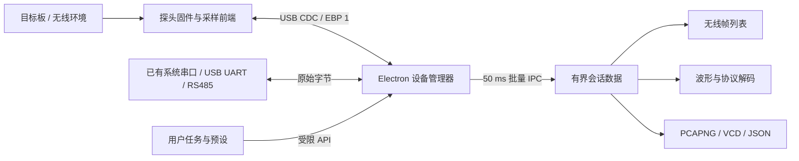

# 产品与软件架构

## 产品边界

EBED Studio 是独立的嵌入式调试软件。自有 dongle 是增加 Wi-Fi 采集能力和套餐价值的选配产品。串口、网络、日志、脚本和离线分析的开发与交付不等待自有硬件；不通过 dongle 身份或购买状态限制基础软件工作流。参见 [产品定位](PRODUCT_POSITIONING.md)。

## 桌面 GUI + Web 界面技术

GUI 与 HTML 不互斥。选择 Electron 提供本地能力，React/HTML 构建 GUI，交付 Windows 免安装 EXE。用户不启动服务器、不安装运行时、不编辑配置文件；浏览器版提供演示与离线分析。

| 方案 | 设备与文件能力 | 结论 |
| --- | --- | --- |
| 独立网页 | Web Serial 授权受浏览器约束，无原生 TCP/UDP | 辅助预览、配置、离线分析 |
| Electron + React | 内置环境；本地串口、网络、文件 | 首版采用；包体较大 |
| 原生 Qt 等 | 本地能力充足，需重写现有界面 | 高性能需求经测量后再决定迁移 |

在 S3 上托管配置网页可以作为辅助。如果为访问网页连接 Wi-Fi，会占用监听射频，不能取代 USB 上位机。

## 开箱流程

1. 双击程序，每三秒枚举系统串口，唯一端口自动选中。默认普通串口，按目标配置波特率、数据位、校验、停止位与流控，点击后连接。
2. 普通串口直接启用 UART 持续接收与手动发送、Modbus RTU FC03。无 hello、心跳或 EBP 封装，不要求专用板卡、固件或厂商身份。串口打开时控制线行为由适配器驱动决定，部分开发板可能因 DTR/RTS 变化复位。
3. 选配 dongle 在制造阶段完成 USB 身份、唯一序列号、板卡映射、采样标定和固件烧录。在“连接接口”中显式选择 EBP 扩展设备后才发送 hello。
4. dongle hello 返回版本、功能、地区信道、接线、采样范围。握手不驱动 GPIO、不自动抓包；正确 CDC 描述符支持 Windows 内置驱动加载。
5. 按目标确认接线、电压、地址，再执行。普通串口传输不依赖固件 ACK；Modbus 校验实际响应；dongle 命令需要 EBP ACK。
6. 就地分析，导出串口日志 / PCAPNG / VCD / JSON；基础操作不依赖 Wireshark 等外部工具。

“一键 debug”指已知器件预设的一次可复现事务。未知 UART 波特率、SPI 模式、I²C 地址和寄存器语义不能凭空确定。后续通过被动测量和器件描述库给出带置信度建议；默认不做主动总线扫描或批量写入。

## 数据架构

连接能力依据接口与固件报告，厂商名称只作展示。普通串口收发与 Modbus 使用原始字节；EBP 设备可以仅声明 Wi-Fi，采样和总线能力均可为空。后续第三方适配器通过各自协议提供统一的采集或总线能力，不能向任意串口发送 EBP 握手来假定兼容。

DeviceHub 统一路由普通串口和 EBP 探头，并在枚举期间保留端口，避免与旧工具箱抢占。SerialManager 处理原始字节、50 ms 批量 IPC、发送排空和 Modbus 响应校验；普通串口能力由主机给出，protocol 为 null。ProbeManager 负责 EBP 分帧、CRC、序号、超时与心跳，固件 protocol 仍须为 1。Preload 暴露特定方法，不开放任意 IPC。Electron 开启上下文隔离和沙箱，禁止 Node 注入和外部导航。生产页面限制内容来源，设备文本按不可信数据校验且不作为 HTML 执行。

dongle 的 Wi-Fi、BLE、逻辑和总线在首版互斥，避免射频、GPIO、DMA、USB 争用。命令等待与数据流分开；ACK 丢失后断开，硬件状态未知时不继续执行。USB 断开和固件看门狗均需恢复高阻。

无线缓存 2,000 条，渲染 500 条；IPC 队列最多 512 条，每 50 ms 刷新；逻辑最多 32,768 点。分别显示固件丢弃、队列丢弃和 UI 淘汰。长期无损记录需后续二进制块、后台解析、信用流控和流式磁盘写入。

设备微秒计时按连接后的首个事件接收时间对齐主机 UTC，相同设备内保留相对时间，绝对时间含 USB 排队误差；目前没有跨设备精确同步。

## 完成情况与路线

| 阶段 | 内容 | 验收 |
| --- | --- | --- |
| 已实现 | 普通串口直连、UART 终端、Modbus 主站、新工作台、USB 主机、能力校验、无线分析/导出、逻辑解码、总线命令、会话、Windows 打包 | 自动测试、交互与发布运行时检查 |
| 软件 P0 已实现 | 统一连接工作区、多连接、参数与命令持久化、错误/取消/断开恢复、日志过滤导出、顺序/重复发送；真实本机 TCP/UDP/MQTT 测试 | 物理串口、远端 Broker/TLS 与长期压力继续实测 |
| 效率 P1 | 器件/寄存器描述库、脚本与日志协同、事务断言、诊断建议 | 可复现且误判可见 |
| Wi-Fi 配件（并行） | S3、USB CDC/EBP、Wi-Fi 帧与元数据、丢包统计、出厂烧录与恢复 | 独立验证即插即用与真实抓包，不阻塞软件发布 |
| 接口扩展 | 第三方采样/总线后端、BLE 扫描及独立 sniffer、CAN 适配、持续会话 | 逐项适配与硬件实测，非自有配件绑定 |
| 发布工程 | 应用签名、固件更新/回滚、多系统包 | 安装与升级验收矩阵 |

软件交付与 Wi-Fi 配件研发并行。当前后端只有普通串口和 EBP 设备，第三方适配是后续方向；不能将接口规划或模拟界面称为已完成真实采集支持。

## 0.3.0 连接工作区实现

`ConnectionManager` 管理串口、TCP 客户端、UDP IPv4 和 MQTT 的生命周期；旧工具箱复用同一后端。连接成功、监听完成、MQTT SUBACK 确认后才发出 open 状态。失败和取消会移除会话、拒绝待完成操作；串口关闭期间继续保留端口，防止竞争重开。

`useConnections` 在 App 根部订阅批量事件，各连接独立维护状态、字节数、日志和发送计划，所以导航切换不关闭连接。主进程每 50 ms 推送一批，最多缓存 512 条 / 1 MB；每条最大显示 64 KB，超出部分标记截断。渲染层每连接最多 500 条。计数区分线上的字节、IPC 丢弃和 UI 淘汰。

连接配置与快捷命令使用版本化本地存储（最多 50 个 / 总计 2 MB），导入时校验、分配新标识并合并，不自动连接。损坏配置保留 recovery 副本；存储失败时提示用户导出。MQTT 密码只存于运行时，配置白名单会剔除密码和 URL 内嵌凭证。发送草稿按连接隔离，日志需显式导出保存。

所有计划在第一条发送前校验命令；一次只等待当前发送完成再进入间隔。停止、断开、发送失败会终止后续计划。MQTT 不隐式重连，避免故障恢复后自动续发。旧工具箱与主工作区的事件按连接 ID 隔离。

连接工作区与总线调试页当前仍有各自的事务流程，同一串口需要先断开再切换；后续可统一 Modbus 事务源。TCP 服务端、UDP 广播开关、流式磁盘记录、完整自动重连策略和通用第三方适配器尚未实现。
